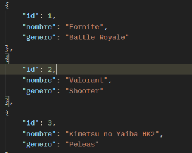
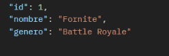
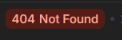
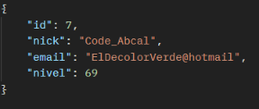
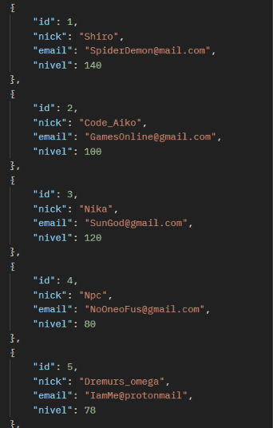

# Pruebas de GameArena (Postman)

Pruebas simples para comprobar la API
## 1. Videojuegos
### 1.1 Crear videojuego
- **POST** y **GET** `/videojuegos`
{ "nombre": "CS:GO", "genero": "Shooter" }

### 1.3 Buscar videojuego por id
- **GET** `/videojuegos/1`

### 1.4 Buscar un videojuego que no existe
- **GET** `/videojuegos/99`
- **Esperado:** 404.

---
## 2. Jugadores
### 2.1 añadir un jugador
- **POST** 
- 
- **GET**
- 
